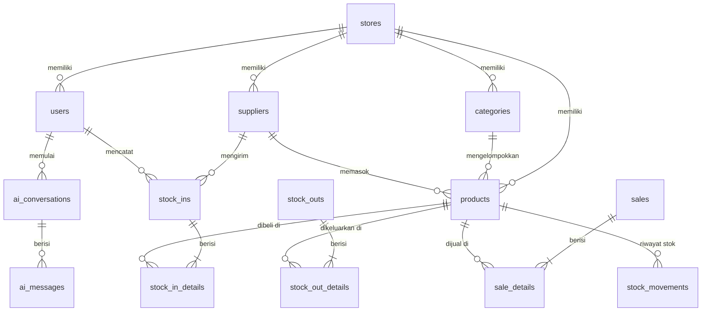

# Dokumentasi Database StokCerdas AI

Semua tabel bisnis memiliki `store_id` agar data antar toko tidak tercampur.
Stok disimpan dalam satuan terkecil (`products.unit`); kemasan dikonversi lewat
`products.units_per_pack`.

## Catatan penting
- `stock_movements` adalah buku besar stok: `stock_after` entri terakhir sama dengan `products.stock`.
- `sale_details.unit_price` dan `unit_cost` adalah snapshot harga saat transaksi.
- `products` memakai soft delete; kode barang unik per toko (termasuk yang sudah dihapus).
- `ai_messages.is_simulation = true` menandai jawaban mode demo (bukan AI sungguhan).
